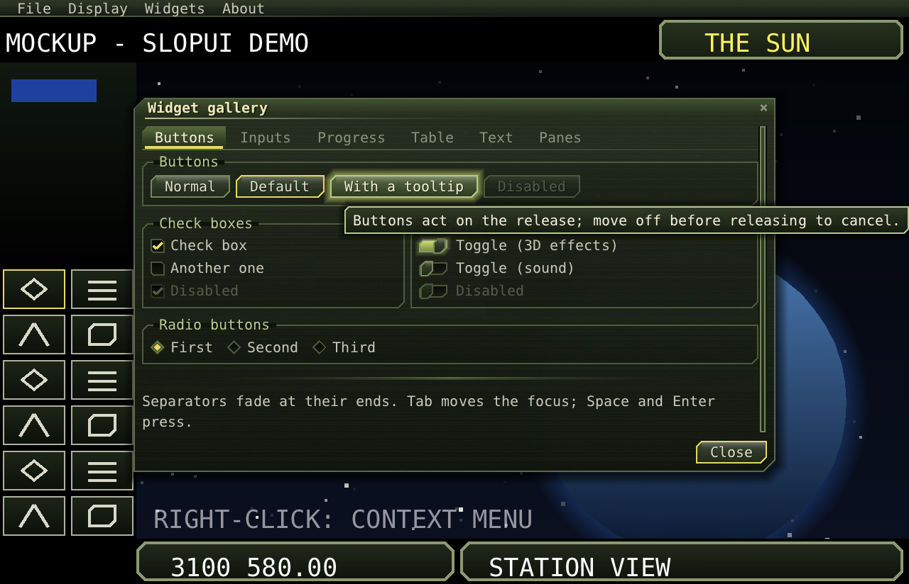

# SlopUI

A small UI toolkit for games: menus, windows, dialogs and widgets that the game draws itself, over its own picture.
It is themable, sized to the window, and works with mouse and keyboard. There are two versions with the same
classes and names: **Java** and **C++23**.

- **Widgets:** button, check box, toggle, radio buttons, text field and text area, number field, dropdown,
  combobox, date picker, slider, progress bar, table, tabs, split and scroll panes, group box, image, separator,
  label, tooltips, toasts, windows and dialogs, menus and context menus.
- **Sized to the window:** the UI scales with the window, or by a setting. Windows stay on screen and scroll what
  doesn't fit; rows of buttons wrap and forms stack when narrow. Fullscreen hides the menu bar until the pointer
  reaches the top edge.
- **Game look:** cut corners, gradients, a brushed texture, glows and short animations, all set by a theme file.
- **Game rules:** buttons act on release (moving off cancels); input the UI doesn't use goes to the game.
- **Any renderer:** the toolkit draws triangles through a small `Painter` interface. OpenGL backends are
  included: LWJGL/GLFW (Java), and SDL3 with OpenGL 3.3 or ES 3.0 (C++).

## Documentation

**[docs/](docs/README.md)**: getting started in [Java](docs/getting-started-java.md) and
[C++](docs/getting-started-cpp.md), [concepts](docs/concepts.md), [layout](docs/layout.md),
[widgets](docs/widgets.md), [windows and dialogs](docs/windows.md), [menus](docs/menus.md),
[theming](docs/theming.md), [backends](docs/backends.md), [examples](docs/examples.md).

## Repository

| Folder | What |
|---|---|
| [`java/`](java/) | The Java version (Gradle): `core` (the toolkit: plain Java 21, no GL/AWT/Swing), `gl` (LWJGL backend), `demo`. |
| [`cpp/`](cpp/) | The C++ version (CMake): `slopui` (the toolkit), `slopui_sdl` (SDL3/OpenGL backend), `slopui_demo`. |
| [`themes/`](themes/) | Theme files (the Dark theme). |
| [`docs/`](docs/) | The documentation. |

The two versions are kept in step by hand. A change to one is carried over to the other with the same class,
member and file layout.

## Building and running the demo

    # Java (Gradle needs Java 21 or newer to run)
    cd java && ./gradlew :demo:dist
    java -jar ../dist/slopui-demo-0.2.3.jar

    # C++ (SDL3 needed)
    cmake -S cpp -B build -G Ninja -DCMAKE_BUILD_TYPE=Release && ninja -C build
    build/slopui_demo

Options: `--font FILE`, `--title-font FILE` (TrueType; fonts are not included, and without them the demo uses a
system monospaced font), `--ui-size 0-4` (0 = Auto), `--theme N`, `--open gallery|prefs|disks|load|editors`.

## Licence

Public domain ([The Unlicense](LICENSE)). `cpp/third_party/stb/stb_truetype.h` is by Sean Barrett, public domain
or MIT.
