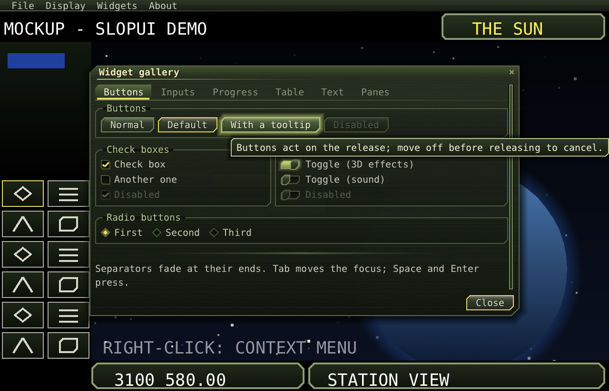

# SlopUI documentation

SlopUI is a small UI toolkit for games: menus, windows, dialogs and widgets that the game draws itself, over its
own picture. There are no native widgets and no platform UI library. It comes in two versions with the same classes
and names: **Java** (`java/`) and **C++23** (`cpp/`).

## Contents

| Page | What it covers |
|---|---|
| [Getting started: Java](getting-started-java.md) | Adding SlopUI to a Java project, a first window, the run loop. |
| [Getting started: C++](getting-started-cpp.md) | Adding SlopUI to a CMake project, a first window, the run loop. |
| [Concepts](concepts.md) | The `Ui`, its layers, UI units and scaling, input routing, focus, ownership. |
| [Layout](layout.md) | `Box`, `Grid`, `ScrollPane`, `SplitPane`, `Tabs`, `GroupBox`; how windows size and rearrange. |
| [Widgets](widgets.md) | Every widget: what it does, mouse and keyboard, code in both languages. |
| [Windows, dialogs and popups](windows.md) | `Window`, modal windows, the ready-made dialogs, toasts, tooltips. |
| [Menus](menus.md) | The menu bar, submenus, ticks and radio marks, shortcuts, context menus. |
| [Theming](theming.md) | Theme files, every colour and size, fonts, the skin. |
| [Backends](backends.md) | `Painter` and `Host`: the included OpenGL backends, and how to write your own. |
| [Examples](examples.md) | Complete small programs: a settings window, a file dialog, a game HUD menu. |

## At a glance

- **Drawn by the game:** the toolkit draws triangles through a `Painter`, which you can implement on any renderer.
  OpenGL backends are included: LWJGL/GLFW for Java, and SDL3 with OpenGL 3.3 or ES 3.0 for C++.
- **Sized to the window:** one UI unit is a whole number of device pixels, chosen from the window's height or set
  by the player. Windows take at most 92% of the screen and scroll what doesn't fit. Rows of buttons wrap, forms
  stack, and tabs move from the side to the top when narrow.
- **Game look:** cut corners, gradients, a brushed texture, glows and short animations, all from a theme file.
  A flat theme is included too.
- **Game rules:** buttons act on release, and moving off before releasing cancels. The UI takes the input
  it needs and passes the rest to the game underneath.
- **Keyboard:** Tab moves between fields; Enter and Escape work in dialogs; F10 or Alt + letter open the menus,
  and the arrow keys move through them.

## The demo

Both versions include a demo: the toolkit over a mockup game screen. The *Widgets* menu opens every widget (F1
opens the gallery), a Preferences window, editors, panes and dialogs. *Display* changes the window size,
fullscreen (F11), the UI size and the theme. Right-click the game for a context menu.

    # Java
    cd java && ./gradlew :demo:dist && java -jar ../dist/slopui-demo-0.2.5.jar
    # C++
    cmake -S cpp -B build -G Ninja && ninja -C build && build/slopui_demo

Options for both: `--font FILE`, `--title-font FILE`, `--ui-size 0-4` (0 = Auto), `--theme N`,
`--open gallery|prefs|disks|load|editors` and (Java) `--fullscreen`. Fonts are not part of SlopUI. Without `--font`, the demo uses a system
monospaced font (DejaVu Sans Mono, Noto Mono or Consolas).
