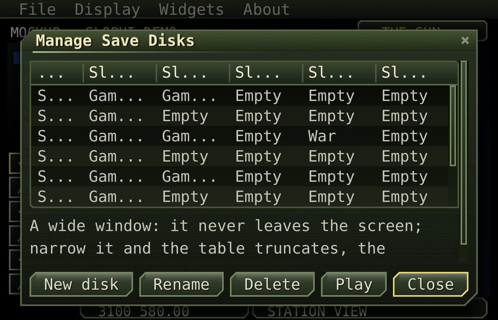
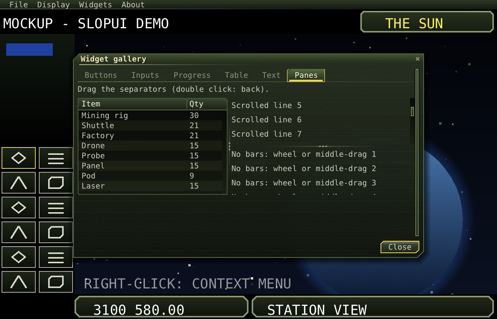
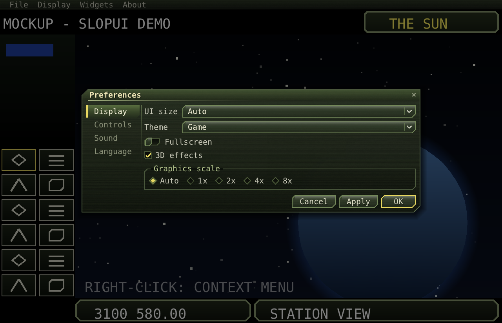
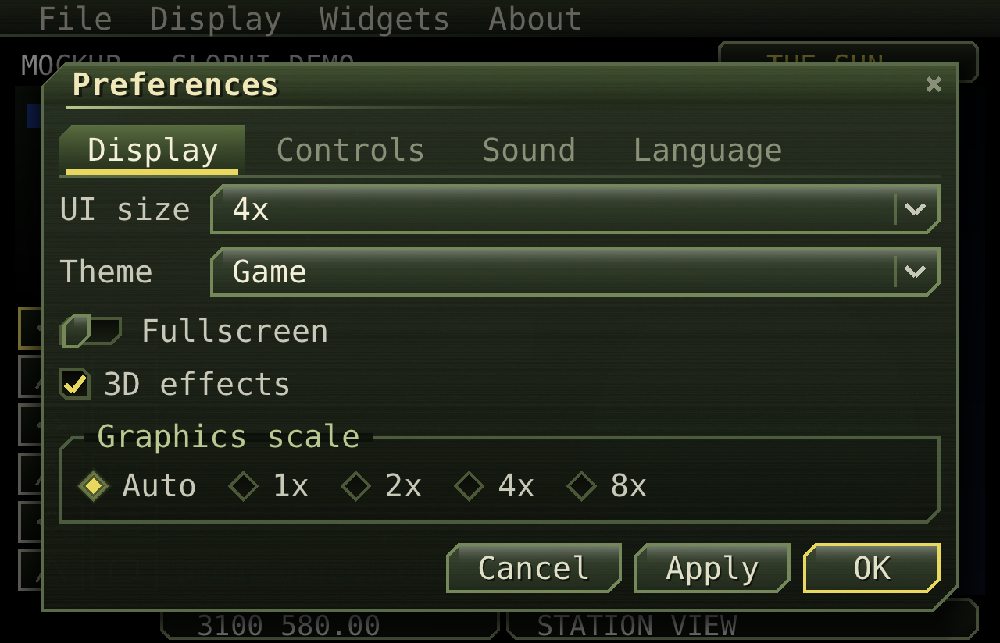

# Layout

Layout happens in two passes: every widget reports its sizes, then its parent places it. Containers decide the
places. The rules are built to keep the UI usable at any window and UI size: rows wrap, forms stack, windows
scroll.

## Sizes a widget reports

| Method | Meaning |
|---|---|
| `prefWidth(ui)` | The width it would like. |
| `minWidth(ui)` | The least width it can work with. Text wraps and tables shorten their text to fit. |
| `prefHeight(ui, width)` | The height it needs at that width (wrapped text gets taller as it gets narrower). |
| `grow` | Its share of the spare room in a `Box` (0: none). |

## Box: rows and columns

```java
Box row = Box.row(a, b, c);                 // side by side
Box col = Box.column(a, b, c);              // one under the other
row.gap(6).pad(4);                          // spacing between children / around them (default gap: theme GAP)
row.justify(1);                             // with spare room and nothing growing: 0 left, 0.5 centre, 1 right
row.responsive();                           // wrap onto more lines when it doesn't fit
b.grow(1);                                  // b takes the spare room
```

```cpp
auto row = Box::row({a, b, c});
row->gap(6).pad(4).justify(1).responsive();
b->grow = 1;
```

- **Along a row:** each child gets its preferred width, and spare room is shared by `grow`. When the row is
  short of room, children shrink towards their least width, the ones with the most slack first.
- **A responsive row** wraps onto more lines when even the least widths don't fit. Each line is then shared
  out across the width. A window's buttons work this way, as below.
- **Across:** children stretch to the row's height, or the column's width.
- **In a column**, spare height goes to children that grow.



## Grid: forms

```java
Grid form = new Grid(2);                    // label, field, label, field...
form.add(new Label("Name"), new TextField("")).add(new Label("Volume"), new Slider(0, 100, 1, 70));
form.columnGrow(0, 1);                      // the second column takes the spare room (the default: the last one)
```

Each column is as wide as its widest preferred child. If the columns' least widths don't fit, the grid stacks into
a single column, with each label above its field.

## ScrollPane

```java
ScrollPane withBars = new ScrollPane(content, true);         // scroll bars to drag
ScrollPane noBars = new ScrollPane(content, false);          // the wheel and middle-button drag only
withBars.viewHeight(120);                                    // ask for at most 120 units of height
```

The content is laid out at the view's width, or its own least width if that is wider; then it also scrolls
sideways. Scrolling is smooth. Pressing the track moves by a page. `reveal(ui, y, h)` scrolls a rectangle into
view, and the Ui does this for the focused widget when Tab moves to it.

## SplitPane: a draggable separator

```java
SplitPane split = new SplitPane(left, right, false, 0.4f);   // side by side, left gets 40%
SplitPane stack = new SplitPane(top, bottom, true, 0.5f);    // one over the other
```

Drag the separator to resize; a double click puts it back. Each side keeps at least its least width.



## Tabs

```java
Tabs tabs = new Tabs().add("Display", displayPage).add("Sound", soundPage);
tabs.sideWhenWider(330);                    // a list on the left when at least 330 units wide
```

Narrow tabs sit on top and wrap onto more lines. From `sideWhenWider` on, they become a list on the left. A sliding
accent marks the open tab. With the tabs focused, Left/Right (or Up/Down at the side) switch pages; Ctrl+Tab
switches from anywhere inside. The height is the tallest page's, so the window doesn't jump when you switch.

| Wide: tabs at the side | Narrow (UI size 4x): tabs on top, wrapped |
|---|---|
|  |  |

## GroupBox

```java
new GroupBox("Graphics scale", radios);
```

A titled frame around its content, with the title set into the top edge.

## How windows size themselves

A window asks for its content's preferred width (or `width(w)`), and at least the content's least width. It is
then kept within `maxWindow` (92%) of the UI's width and height. Content that doesn't fit the height scrolls. The
buttons along the bottom are a responsive row that wraps. A window is centred when it opens and kept inside the UI
when the UI changes size.
