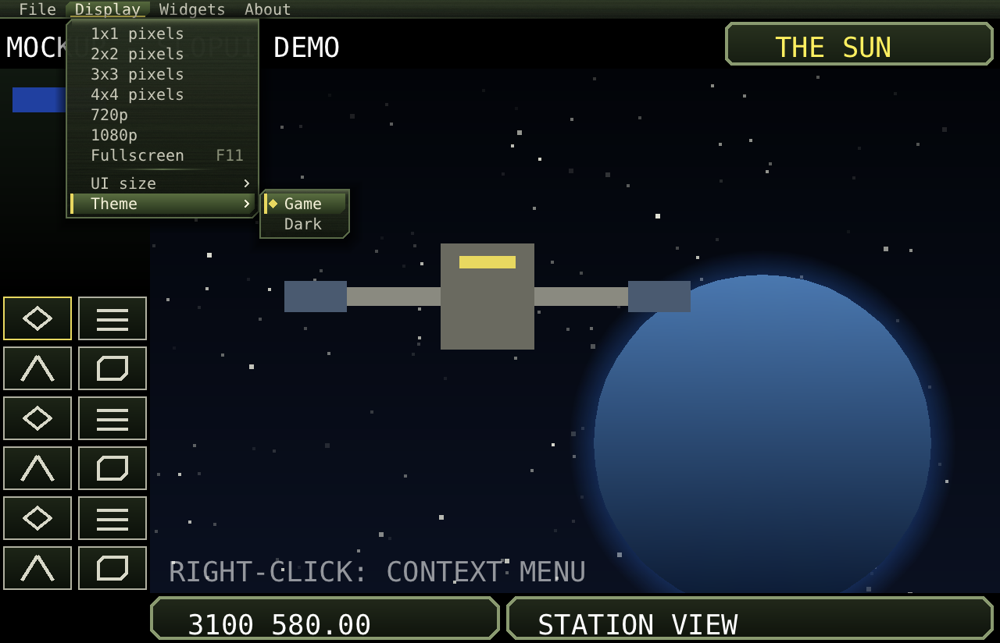
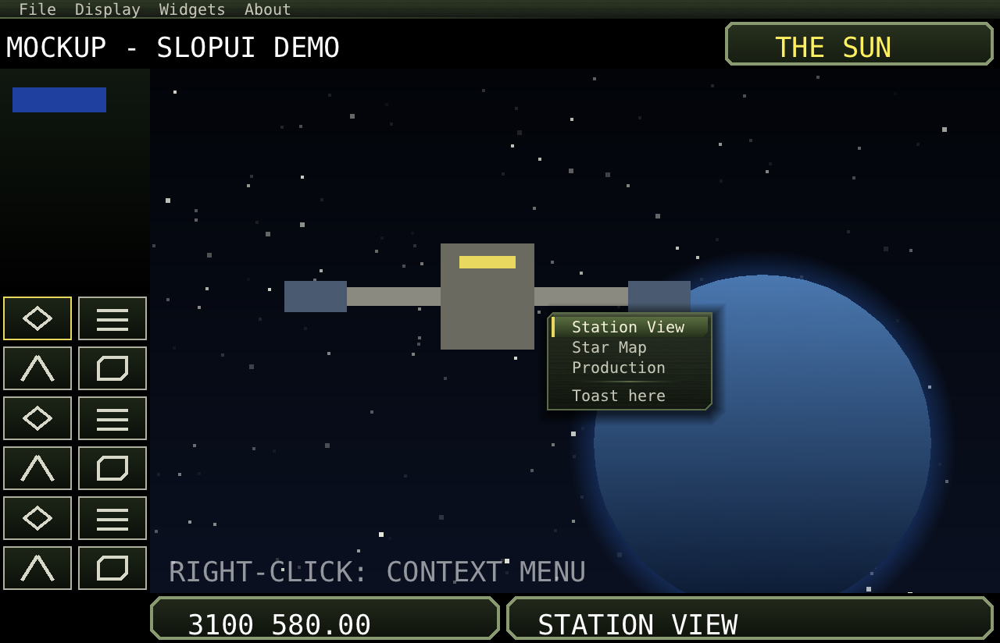

# Menus

## The menu bar

```java
Menu file = new Menu("File");
file.add(MenuItem.action("New Game", this::newGame));
file.add(MenuItem.action("Save Game...", this::save).shortcut("Ctrl+S"));   // shown at the right
file.separator();
file.add(MenuItem.action("Quit", host::requestClose));

Menu display = new Menu("Display");
display.add(MenuItem.action("Fullscreen", () -> host.setFullscreen(!host.fullscreen()))
        .check(host::fullscreen).shortcut("F11"));                          // a tick while true
Menu size = new Menu("UI size");
for (int i = 0; i < 5; i++) {
    int s = i;
    size.add(MenuItem.action(i == 0 ? "Auto" : i + "x", () -> host.setUiScale(s))
            .radio(() -> host.uiScale() == s));                             // a radio mark while true
}
display.add(MenuItem.submenu(size));

ui.menuBar.add(file).add(display);
ui.shortcut(Keys.F11, () -> host.setFullscreen(!host.fullscreen()));         // the key itself
```
```cpp
auto file = std::make_shared<Menu>("File");
file->item("New Game", [&] { newGame(); });
file->item("Save Game...", [&] { save(); }).shortcut("Ctrl+S");
file->separator();
file->item("Quit", [&] { host.requestClose(); });
auto display = std::make_shared<Menu>("Display");
display->item("Fullscreen", [&] { host.setFullscreen(!host.fullscreen()); })
    .check([&] { return host.fullscreen(); }).shortcut("F11");
ui.menuBar->add(file).add(display);
```



## Items

| Item | Java | C++ |
|---|---|---|
| An action | `MenuItem.action(label, action)` | `menu->item(label, action)` |
| A submenu | `MenuItem.submenu(menu)` | `menu->add(MenuItem::sub(sub))` |
| A separator | `menu.separator()` | `menu->separator()` |
| A tick | `.check(() -> on)` | `.check([] { return on; })` |
| A radio mark | `.radio(() -> selected)` | `.radioMark([] { return selected; })` |
| Disabled | `.enabled(() -> canSave)` | `.isEnabled([] { return canSave; })` |
| Shortcut text | `.shortcut("F11")` | `.shortcut("F11")` |

Labels can be suppliers (`MenuItem.action(() -> texts.get("Quit"), ...)` in Java), read each time they're drawn.
A menu can rebuild its items each time it opens:

```java
Menu recent = new Menu("Recent");
recent.onOpen(() -> {
    recent.clear();
    for (String f : recentFiles()) recent.add(MenuItem.action(f, () -> open(f)));
});
```

## Using the menus

| Input | Does |
|---|---|
| Press a title | Opens its menu; pressing it again closes it. |
| Pointer over another title while a menu is open | Opens that menu. |
| Press a title, drag to an item, release | Runs the item, as native menus do. |
| Click an item | Runs it on the release. |
| Pointer over a submenu item | Opens the submenu to the side (to the left if there is no room on the right). |
| F10 / Alt + a title's first letter | Opens the first / that menu, with the first item selected. |
| Up/Down, Left/Right | Move through the items / open or close submenus, then the next or previous menu. |
| Enter, Space | Runs the item or opens its submenu. Escape closes one level. |
| Wheel | Scrolls a menu taller than the UI. |

In fullscreen (`ui.setBarAutoHide(true)`, which the included hosts set), the bar is hidden until the pointer
reaches the top edge. It stays while the pointer is on it or a menu is open.

## Context menus

```java
@Override public boolean press(Ui ui, float mx, float my, int button, int clicks) {
    if (button == 1) {
        Menu m = new Menu("Station");
        m.add(MenuItem.action("Rename...", this::rename), MenuItem.action("Scrap", this::scrap));
        ui.contextMenu(m);           // opens at the pointer
        return true;
    }
    return false;
}
```
```cpp
auto m = std::make_shared<Menu>("Station");
m->item("Rename...", [&] { rename(); });
ui.contextMenu(m);
```


