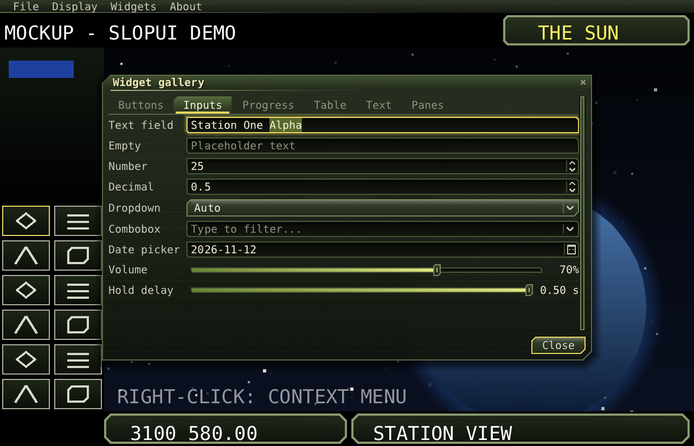
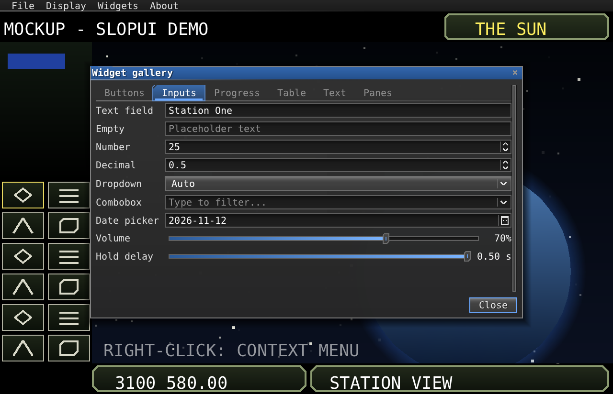

# Theming

How everything looks comes from a `Theme`: its colours, sizes and fonts. The drawing itself is in `Skin`: textured
gradient panels with cut corners, bevelled buttons that glow on hover, and recessed fields. The default `Theme()`
is the built-in game look. `themes/dark.json` is a flat grey-and-blue theme.

| Game (built in) | Dark (`themes/dark.json`) |
|---|---|
|  |  |

## Using a theme

```java
Theme base = new Theme();                                   // the built-in look
Theme dark = base.read(Files.readString(Path.of("themes/dark.json")));   // a file over it: missing keys keep base's
dark.font = myFont;                                         // fonts are not in theme files
ui.theme = dark;                                            // takes effect on the next frame
System.out.println(dark.write());                           // a theme as a theme file
```
```cpp
Theme base;
Theme dark = base.read(readFile("themes/dark.json"));      // throws std::runtime_error on bad JSON
dark.font = TtfFont::load("fonts/MyFont.ttf", 10);
ui.theme = dark;
```

The Java core jar contains the themes in `themes/` as resources, so `Theme.class.getResourceAsStream(
"/slopui/themes/dark.json")` works.

In code, colours are `theme.c[Theme.TEXT]` (C++ `theme.c[Theme::TEXT]`) and sizes are `theme.s[Theme.ROW]`.

## Theme files

JSON, with `//` comments allowed. Colours are `"#RRGGBB"` or `"#AARRGGBB"`. Sizes are in UI units, and times in
seconds.

```json
{
  "name": "Ice",
  "colours": { "accent": "#7FD8FF", "panelTop": "#F01A2630", "panelBottom": "#F00A1016", "glow": "#907FD8FF" },
  "sizes": { "cut": 6, "textureStrength": 0.1, "hoverTime": 0.08 }
}
```

### Colours

| Key | Default | Used for |
|---|---|---|
| `text` | `#FFC8C8B8` | Normal text. |
| `textDim` | `#FF8A9078` | Placeholders, shortcuts, unselected tabs. |
| `textDisabled` | `#FF545C48` | Disabled widgets' text. |
| `textBright` | `#FFF4F0D8` | Typed text, hovered and selected items, titles. |
| `accent` | `#FFE8D860` | Ticks, carets, the default button's edge, menu and tab marks. |
| `accentSoft` | `#FFB8C890` | Group box titles, hovered edges, weekends, tooltips' edge. |
| `panelTop`, `panelBottom` | `#F2242C1E`, `#F20C100A` | Windows', menus' and popups' gradient. |
| `panelBorder` | `#FF5A6A48` | Panels' edges, separators, table lines. |
| `panelLight` | `#50B8C890` | The light along a panel's top edge. |
| `titleTop`, `titleBottom` | `#FF3E4E2E`, `#FF1A2214` | The front window's title bar. |
| `titleText` | `#FFF0E8B8` | The front window's title. |
| `barTop`, `barBottom` | `#F02C3624`, `#F0101410` | The menu bar. |
| `buttonTop`, `buttonBottom` | `#FF3A4630`, `#FF1A2216` | Buttons, knobs, table headers, scroll thumbs. |
| `hoverTop`, `hoverBottom` | `#FF5A6E40`, `#FF26321C` | Hovered buttons, menu and list items, tabs. |
| `pressTop`, `pressBottom` | `#FF10140C`, `#FF2C3822` | Pressed buttons. |
| `buttonBorder` | `#FF74885A` | Buttons' edges. |
| `buttonText` | `#FFE0E0C8` | Buttons' text. |
| `fieldTop`, `fieldBottom` | `#FF080A06`, `#FF141810` | Text fields, tables, check boxes, tracks. |
| `fieldBorder` | `#FF4A5838` | Fields' edges. |
| `focus` | `#FFE8D860` | The focused widget's edge and glow. |
| `selection` | `#FF586A2C` | Selected text and table rows. |
| `selectionText` | `#FFFFFFE8` | Text in selected rows. |
| `rowHover` | `#28B8C890` | The hovered table row. |
| `rowAlt` | `#10B8C890` | Every other table row. |
| `trackTop`, `trackBottom` | `#FF080A06`, `#FF1A2014` | Scroll bar and toggle tracks. |
| `fillTop`, `fillBottom` | `#FFE0E880`, `#FF6A8434` | Progress, sliders, a toggle that's on, the chosen day. |
| `glow` | `#90D0E070` | Hover glow. |
| `shadow` | `#A0000000` | Shadows under windows, menus and tooltips. |
| `shade` | `#80000000` | Over everything under a modal window. |
| `warning` | `#FFFF7060` | The close button on hover. |
| `tooltipTop`, `tooltipBottom` | `#F8303C26`, `#F8141A10` | Tooltips. |
| `texture` | `#FFB8C890` | The panel texture's tint. |

### Sizes and times

| Key | Default | Meaning |
|---|---|---|
| `row` | 12 | Height of a line: check boxes, menu and list items, table rows. |
| `buttonHeight` | 16 | Buttons, dropdowns. |
| `pad` | 6 | Space inside windows and group boxes, and between form columns. |
| `gap` | 4 | Space between children of rows and columns. |
| `cut` | 4 | Size of the cut corners (0: square). |
| `border` | 1 | Edge thickness. |
| `glowSize` | 5 | How far the hover glow reaches. |
| `titleHeight` | 14 | Window title bars. |
| `barHeight` | 12 | The menu bar. |
| `scrollbar` | 6 | Scroll bar width. |
| `splitter` | 5 | A split pane's separator. |
| `shadowSize` | 8 | Shadows. |
| `textureStrength` | 0.07 | The panel texture's strength (0: none). |
| `hoverTime` | 0.12 | Seconds a hover takes to fade in and out. |
| `pressTime` | 0.06 | Seconds a press takes to sink. |
| `openTime` | 0.14 | Seconds a window or popup takes to open. |
| `tooltipDelay` | 0.6 | Seconds before a tooltip shows. |
| `maxWindow` | 0.92 | Share of the UI a window may take. |

## Fonts

`theme.font` draws all text. The title font (`theme.titleFont` in Java, `theme.titleFontOverride` in C++) draws
window titles and title labels, and defaults to the text font.

The included backends' `TtfFont(stream or bytes, size)` takes `size` in UI units per em; 10 gives capitals about
7 units high. Each font covers Latin, Latin-1 and Latin Extended A and B. It is baked again for each pixel size,
so it stays sharp at every UI size.

`FallbackFont(primary, fallback)` joins two fonts. It draws the code points the primary font lacks from the
fallback, centred on the primary's line: for example a pixel-styled font with a fuller font behind it.

A font can be anything that implements `Font`: `has(codepoint)`, `advance(codepoint)`, `lineHeight()` and
`drawGlyph(painter, codepoint, x, y, colour)`.

## The skin

`Skin` has the drawing the widgets share, so your own widgets can match them:

| Function | Draws |
|---|---|
| `Skin.panel(p, t, x, y, w, h, cut, shadow)` | A textured panel with cut corners, a light top edge and a border. |
| `Skin.button(p, t, x, y, w, h, hover, press, enabled, accent, focus)` | A button face; hover and press are 0..1. |
| `Skin.field(p, t, x, y, w, h, focus, enabled)` | A recessed field. |
| `Skin.chevron(p, cx, cy, size, dir, colour)` | An arrow: 0 down, 1 right, 2 up, 3 left. |
| `Skin.tick(p, x, y, size, amount, colour)` | A tick drawn to `amount` (0..1). |
| `Skin.fit(font, text, width)` | The text, shortened with "..." to fit. |

`Shapes` has the shapes underneath: fills, gradients, images, polygons with cut corners (`Shapes.cut`), outlines,
glows, lines and colour blending (`lerp`, `alpha`).
