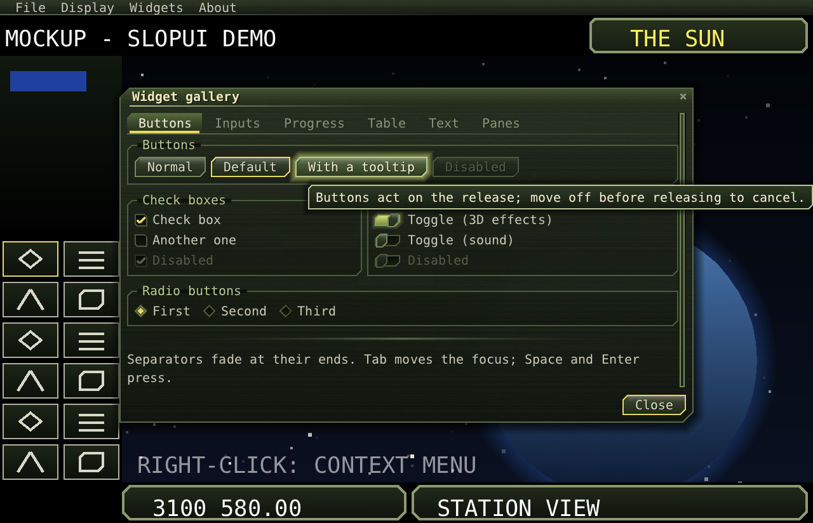
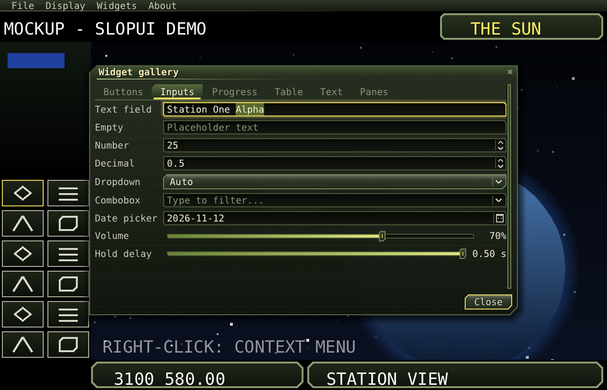
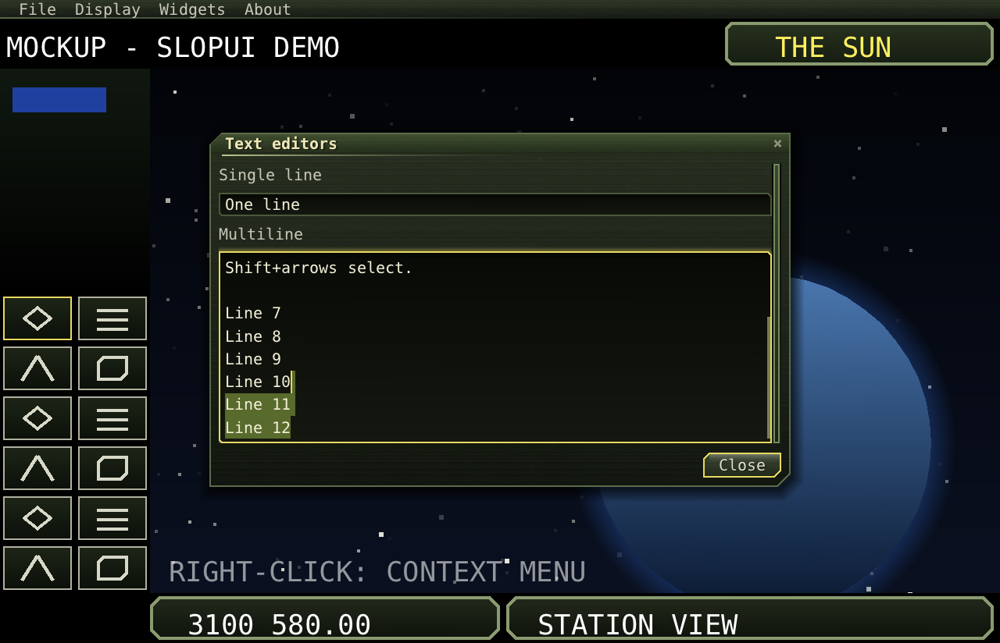
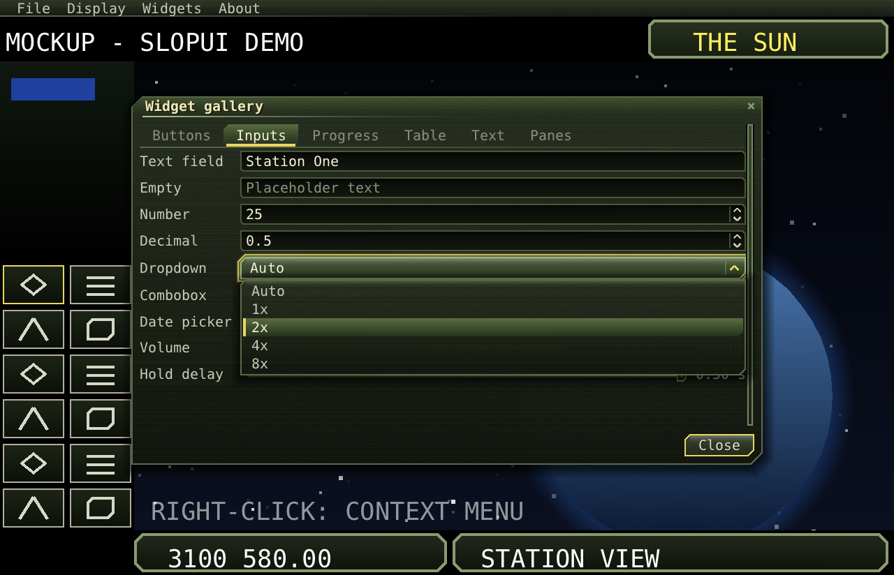
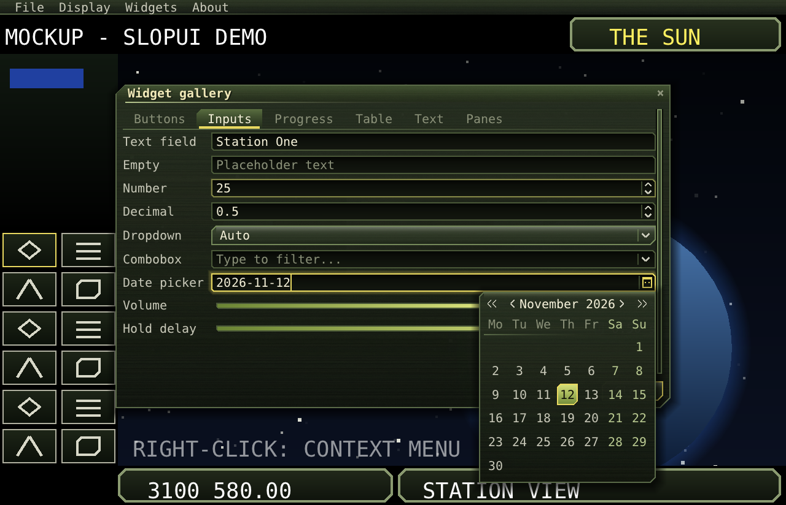
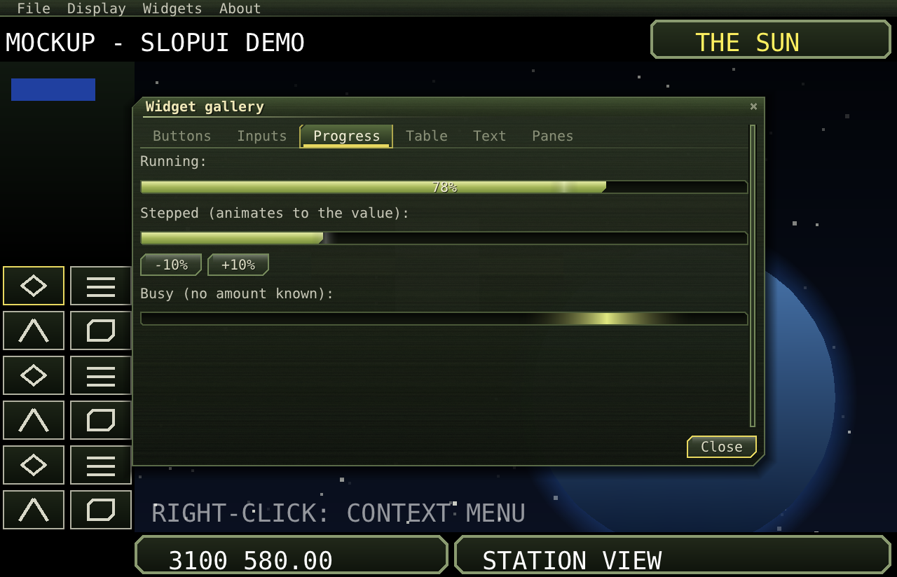
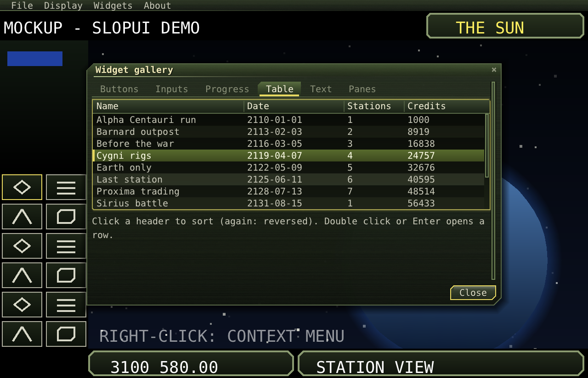
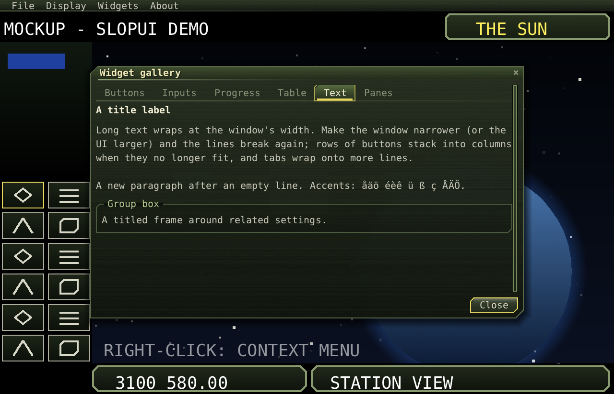

# Widgets

Every widget in both languages, with what the mouse and the keys do. Code is Java first, then C++. The common
parts (`setEnabled`, `setVisible`, `tooltip`, `grow`) are in [Concepts](concepts.md#widgets).

- [Label](#label) · [Button](#button) · [CheckBox](#checkbox) · [Toggle](#toggle) · [RadioButton](#radiobutton)
- [TextField](#textfield) · [TextArea](#textarea) · [NumberField](#numberfield) · [ComboBox](#combobox) ·
  [Dropdown](#dropdown) · [DatePicker](#datepicker) · [Slider](#slider)
- [ProgressBar](#progressbar) · [Separator](#separator) · [Table](#table) · [ImageView](#imageview)
- Containers: [Box, Grid, ScrollPane, SplitPane, Tabs, GroupBox](layout.md)
- Windows, dialogs, toasts, tooltips: [Windows](windows.md) · Menus: [Menus](menus.md)



## Label

Text that wraps at spaces and newlines to its width. Left-aligned by default.

```java
new Label("Some text that wraps.");
new Label(() -> "Credits: " + credits);          // read each time it is drawn
new Label("Title").title();                      // the title font, bright
new Label("Right").align(1).colour(0xFFE8D860); // 0 left, 0.5 centre, 1 right; ARGB (0: the theme's text colour)
new Label("Name in use").warning();             // the theme's warning colour
```
```cpp
make<Label>("Some text that wraps.");
make<Label>(Text([&] { return "Credits: " + std::to_string(credits); }));
auto t = make<Label>("Title"); t->title();
```

## Button

A push button. **It acts on the release over it; moving off before releasing cancels.** It glows on hover, sinks
while pressed, and has a focus outline. Space or Enter presses it when focused.

```java
Button ok = new Button("OK", () -> apply());
ok.accent(true);                                 // the default-button edge (Window.defaultButton sets it)
ok.setEnabled(false);
ok.enabledWhen(() -> table.selected() >= 0);     // enabled only while this holds (checked as it is drawn)
ok.tooltip("Applies the settings");
```
```cpp
auto ok = make<Button>("OK", [&] { apply(); });
ok->accent(true);
ok->setTooltip("Applies the settings");
```

## CheckBox

A box with a tick that draws itself in, and text beside it. It toggles on the release over it, or Space when
focused.

```java
CheckBox c = new CheckBox("3D effects", true).onChange(on -> setEffects(on));
boolean on = c.isOn();
```
```cpp
auto c = make<CheckBox>("3D effects", true);
c->onChange([&](bool on) { setEffects(on); });
```

## Toggle

An on/off switch: the knob slides and the track lights up. It works like `CheckBox` (it is one in C++); Enter
also toggles it.

```java
new Toggle("Fullscreen", false).onChange(on -> host.setFullscreen(on));
```
```cpp
make<Toggle>("Fullscreen", false)->onChange([&](bool on) { host.setFullscreen(on); });
```

## RadioButton

One choice of a `RadioGroup`, shown as a diamond lit when selected. The arrow keys move the selection within the
group.

```java
RadioGroup g = new RadioGroup(0).onChange(i -> setScale(i));
Box row = Box.row(g.button("Auto"), g.button("1x"), g.button("2x")).responsive();
int chosen = g.selected();
```
```cpp
auto g = make<RadioGroup>(0);
g->onChange([&](int i) { setScale(i); });
auto row = Box::row({g->button("Auto"), g->button("1x"), g->button("2x")});
```

## TextField

One line of text to type.

| Input | Does |
|---|---|
| Click / drag | Places the caret / selects. |
| Double click / triple click | Selects a word / everything. |
| Shift + click, Shift + arrows | Extends the selection. |
| Ctrl + Left/Right, Ctrl + Backspace/Delete | Moves or deletes by words. |
| Home / End | Start / end of the text. |
| Ctrl+A, Ctrl+C, Ctrl+X, Ctrl+V | Select all, copy, cut, paste (the host's clipboard). |
| Enter | Runs `onEnter`; without it, Enter goes on to the window (its default button). |

It scrolls sideways when the text is longer than the field. A placeholder shows while it is empty.

```java
TextField name = new TextField("").placeholder("Station name").maxLength(24)
        .allow(c -> Character.isLetterOrDigit(c) || c == ' ')
        .onChange(s -> preview(s)).onEnter(s -> save(s));
String text = name.text();
name.set("Alpha");
name.selectAll();
```
```cpp
auto name = make<TextField>("");
name->placeholder("Station name").maxLength(24).onEnter([&](const std::string& s) { save(s); });
```



## TextArea

Several lines of text. Everything `TextField` does, plus Enter for a new line, Up/Down (keeping the column),
Home/End per line (with Ctrl: the whole text) and Page Up/Down. It scrolls both ways, and the wheel scrolls it.
Tab moves the focus on rather than typing a tab.

```java
TextArea notes = new TextArea("First line\nSecond line", 8);    // 8 rows high
```
```cpp
auto notes = make<TextArea>("First line\nSecond line", 8);
```



## NumberField

A number to type or step. It has arrows at the right (holding one repeats after 0.45 s); Up/Down and the wheel
step it too. It keeps the value within min..max and only takes digits, '.' and '-'.

```java
NumberField n = new NumberField(25, 1, 100, 1, 0)       // value, min, max, step, decimals
        .onValue(v -> setCount((int) Math.round(v)));
```
```cpp
auto n = make<NumberField>(0.5, 0.1, 2.0, 0.1, 1);
n->onValue([&](double v) { setDelay(v); });
```

## ComboBox

A text field with suggestions. Typing filters the list under it, case-insensitively, by any part of the text. The
chevron or Down opens the whole list. Typing goes on into the field while the list is open.

```java
new ComboBox("", List.of("Alpha Centauri", "Barnard's Star", "Sirius"));
```
```cpp
make<ComboBox>("", std::vector<std::string>{"Alpha Centauri", "Barnard's Star", "Sirius"});
```

## Dropdown

Pick one of a fixed list, with no typing. A press opens the list (above the field when there's no room below).
Up/Down change the choice without opening it, and Space or Enter opens it.

```java
new Dropdown(List.of("Auto", "1x", "2x", "4x"), 0).onChange(i -> setScale(i));
```
```cpp
make<Dropdown>(std::vector<std::string>{"Auto", "1x", "2x", "4x"}, 0)->onChange([&](int i) { setScale(i); });
```



## DatePicker

A calendar date, real dates only. Type it as YYYY-MM-DD, or pick it from the calendar under the field: the button
at the right or Alt+Down opens it.

| In the calendar | Does |
|---|---|
| ‹ › / « » | Previous/next month / year. The wheel steps months. |
| Arrow keys | Move the day (crossing months). Page Up/Down: the month. |
| Click a day, Enter | Picks it. |

Weeks start on Monday, today has an accent outline, and weekends are in the soft accent colour. `DatePicker` also
has date helpers: `leap`, `daysIn`, `days` (days since 1970-01-01), `civil` (back), `weekday` (0 = Monday) and
`today`.

```java
int[] t = DatePicker.today();
DatePicker d = new DatePicker(t[0], t[1], t[2]).onDate(ymd -> setDeadline(ymd[0], ymd[1], ymd[2]));
```
```cpp
auto t = DatePicker::today();
make<DatePicker>(t[0], t[1], t[2])->onDate([&](std::array<int, 3> d) { setDeadline(d[0], d[1], d[2]); });
```



## Slider

A value between min and max in steps. Drag the knob, or press the track to jump there. The wheel and the arrow
keys step it; Home/End go to the ends. The value is shown at the right through `format`.

```java
new Slider(0, 100, 1, 70).format(v -> (int) v + "%").onChange(v -> setVolume(v));
new Slider(0.1, 0.5, 0.05, 0.5).format(v -> String.format("%.2f s", v));
```
```cpp
auto s = make<Slider>(0, 100, 1, 70);
s->format([](double v) { return std::to_string(int(v)) + "%"; }).onChange([&](double v) { setVolume(v); });
```

## ProgressBar

How far something has got: `set(0..1)` animates to the value, with a moving sheen. A negative value means busy
(no amount known), and a light sweeps across. Text can be shown on top of it.

```java
ProgressBar p = new ProgressBar(0).text(() -> Math.round(p.value() * 100) + "%");   // (p: a field in practice)
p.set(0.4f);
new ProgressBar(-1);                                 // busy
```



## Separator

A line that fades at its ends, horizontal (`new Separator()`) or vertical (`new Separator(true)`).

## Table

Rows of text in columns.

| Input | Does |
|---|---|
| Click a header | Sorts by it on the release; again: the other way. Numbers sort as numbers. |
| Drag a header | Moves its column: a copy of the header follows the pointer, and an accent line shows where the column will go. |
| Drag a separator between headers | Moves width between the two columns beside it (each keeps at least 16 units). The pointer shows a resize arrow there. |
| Double click a separator | Puts the column widths back to the ones given. |
| Click a row, Up/Down, Page Up/Down, Home/End | Selects a row. |
| Double click, Enter | Activates the selected row (`onActivate`). |
| Wheel, the bar | Scroll. |

Columns share the width by weight (resizing changes the weights, so the columns keep their shares when the
table's width changes), and text that doesn't fit ends in "...". `selected()` and the callbacks use
the row's index in the list you gave, whatever the sort. Moving columns only changes the display:
`columnOrder()` gives the column shown at each position, so you can save the player's order.

```java
Table t = new Table(new String[] {"Name", "Saved", "Credits"}, new float[] {3, 2, 1}, 8);   // 8 rows high
t.setRows(List.of(new String[] {"Alpha", "2026-11-12", "3100"}, new String[] {"Beta", "2026-11-10", "870"}));
t.onSelect(r -> show(r)).onActivate(r -> load(r));
```
```cpp
auto t = make<Table>(std::vector<std::string>{"Name", "Saved", "Credits"}, std::vector<float>{3, 2, 1}, 8);
t->setRows({{"Alpha", "2026-11-12", "3100"}, {"Beta", "2026-11-10", "870"}});
t->onActivate([&](int r) { load(r); });
```



## ImageView

An image from ARGB pixels, scaled to fit its box and centred.

```java
new ImageView(24, 16, pixels, 72, 48, false);       // image size, preferred size in UI units, smooth filtering
```
```cpp
make<ImageView>(24, 16, pixels, 72.0f, 48.0f, false);
```

## Text, wrapping and accents


