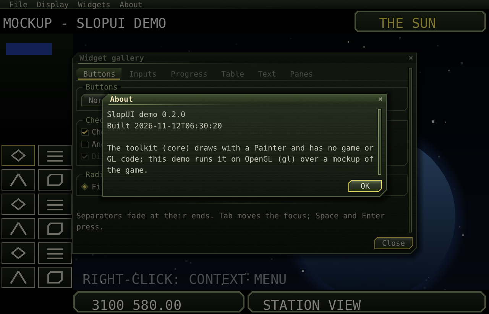

# Windows, dialogs and popups

## Window

A window over the game. It has a title bar to drag it by, a close button, its content in a scroll pane, and a row
of buttons along the bottom that wraps when narrow.

```java
Window w = new Window("Preferences", content)
        .width(420)              // the width it asks for (default: the content's)
        .modal(true)             // default: shades and blocks what is under it
        .closable(true)          // the × in the title bar (runs onCancel)
        .titleBar(true);         // false: a fixed pane, no title bar, can't be dragged
w.onCancel(() -> ui.close(w))    // Escape and ×; default: closes the window
        .onClose(() -> saveLayout());  // after it closed
w.button(new Button("Cancel", () -> ui.close(w)));
w.defaultButton(new Button("OK", () -> { apply(); ui.close(w); }));   // Enter presses it; accent edge
ui.open(w);
```
```cpp
auto self = std::make_shared<std::weak_ptr<Window>>();
auto close = [&ui, self] { if (auto w = self->lock()) ui.close(w.get()); };
auto w = make<Window>("Preferences", content);
w->width(420).button(make<Button>("Cancel", close)).defaultButton(make<Button>("OK", [=] { apply(); close(); }));
*self = w;
ui.open(w);
```

- **Size:** see [Layout](layout.md#how-windows-size-themselves). At most 92% of the UI; the rest scrolls.
- **Place:** centred when opened (`recentre()` centres it again the next time), and kept inside the UI.
- **Order:** a click raises a window, unless a modal window is open.
- **Opening:** it fades in and rises slightly over `openTime`.
- **Focus:** opening a window focuses its first text field.

### Panes

A non-modal window with `titleBar(false)` is a fixed panel. With a title bar, it's a floating pane the player can
drag. The game still gets clicks outside both.

## Ready-made dialogs

```java
ui.message("Saved", "The game was saved.", () -> {});                              // OK
ui.confirm("Quit", "Quit the game?", "Quit", "Cancel", () -> host.requestClose());  // yes / no
ui.ask("Save Game", "Name of the save:", "my game", name -> save(name));            // a text field, OK / Cancel
```
```cpp
ui.message("Saved", "The game was saved.");
ui.confirm("Quit", "Quit the game?", "Quit", "Cancel", [&] { host.requestClose(); });
ui.ask("Save Game", "Name of the save:", "my game", [&](const std::string& n) { save(n); });
```

Each returns its window, which is already open. The buttons' labels are the ones given, apart from OK and
Cancel; replace these helpers with your own if you need other languages.



## Toasts

```java
ui.toast("Saved");
```

A short message at the bottom centre. It slides in, stays about three seconds and fades out. Several stack.

## Tooltips

```java
button.tooltip("Applies the settings");
label.tooltip(() -> "Credits: " + credits);
```

A tooltip shows after the pointer has rested `tooltipDelay` seconds over the widget, or over any child without one
of its own. It stays inside the UI and goes away on the next press.

## Popups

Menus, dropdown lists, combobox suggestions and the calendar are `Popup`s. A popup opens next to an anchor: below
it, or above when there is no room below; submenus open to the side. A press outside all popups closes them, and
that press does nothing else. Escape closes the top one.

To write your own popup, extend `Popup`: set `owner`, call `anchor(...)`, and open it with `ui.openPopup(p)`.
Close it with `ui.closePopup(p)`, which also closes the popups opened after it.
